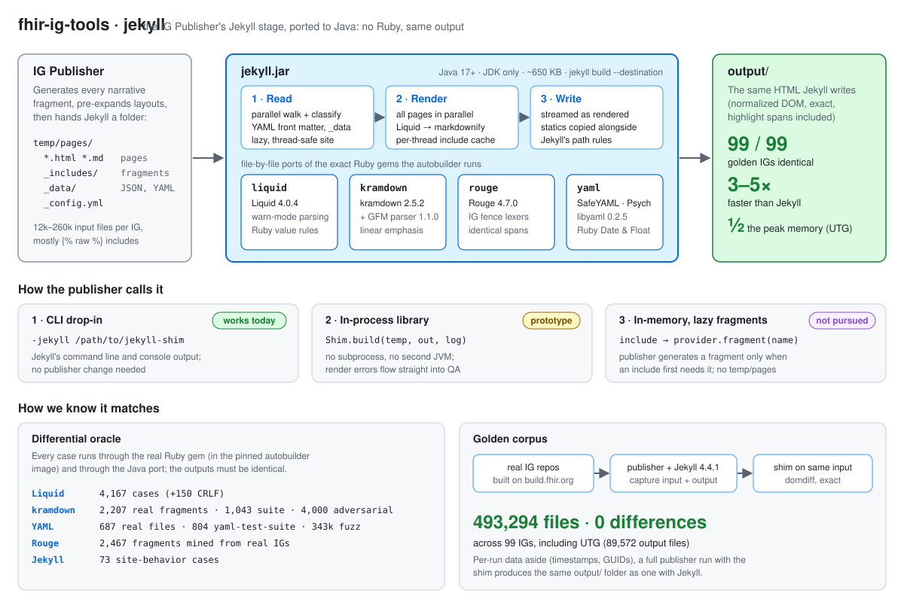

# fhir-ig-jekyll

**Java replacements for the two non-Java stages of the [FHIR IG Publisher](https://github.com/HL7/fhir-ig-publisher):
Jekyll (Ruby) and SUSHI (Node.js). Same output, no Ruby, no Node/npm.**

The IG Publisher is a Java program, but building an IG also runs two other toolchains:

| Stage | What it does | Today | Replacement in this repository | Status |
|---|---|---|---|---|
| FSH compilation | turns `input/fsh/*.fsh` into FHIR JSON under `fsh-generated/`, before the publisher loads the IG | **SUSHI** 3.21.1 (TypeScript, Node.js, npm) | **`sushi/`**, a Java port of SUSHI 3.21.1: `java -jar sushi.jar <ig dir>` | built and tested from source; no release yet |
| Page rendering | renders the narrative pages the publisher writes to `temp/pages` (Liquid, Markdown, syntax highlighting) | **Jekyll** 4.4.1 (Ruby gems) | **`jekyll/`**, "the shim": `-jekyll jekyll-shim` | released ([v0.1.0](https://github.com/jmandel/fhir-ig-jekyll/releases)) |

Both are faithful ports, not look-alikes: each is checked against the original tool, file by file and message by
message, until the output is identical.

| | Fidelity | Evidence |
|---|---|---|
| Jekyll shim | **266 real IGs** (everything build.fhir.org built over a month): **260 identical, 1,024,171 files**; the other 6 cannot be identical by construction (build timestamps, case-only file name clashes, one IG where Jekyll itself fails) | [Results](#results) below; [`docs/TRACKER.md`](docs/TRACKER.md) |
| SUSHI port | **6 / 6 reference IGs** and **267 / 267 FSH IGs of the corpus** (every corpus IG that uses FSH) identical to TypeScript SUSHI 3.21.1: byte-identical `fsh-generated/`, the same console messages, the same exit status; **3,713 JUnit tests**, including 3,584 of SUSHI's 3,604 Jest tests ported 1:1 | [The SUSHI port](#the-sushi-port) below; [`sushi/PORTING.md`](sushi/PORTING.md) §6; [`sushi/docs/differences.md`](sushi/docs/differences.md) |

## Quick start

**Jekyll shim** (Java 17+; Windows: use [`jekyll-shim.cmd`](https://github.com/jmandel/fhir-ig-jekyll/releases/latest/download/jekyll-shim.cmd)):

```sh
curl -fLO https://github.com/jmandel/fhir-ig-jekyll/releases/latest/download/jekyll-shim && chmod +x jekyll-shim
java -jar publisher.jar -ig . -jekyll "$PWD/jekyll-shim"    # first run fetches and verifies shim.jar, then works offline
```

**SUSHI port** (Java 21; build it from source, there is no release asset yet):

```sh
./build.sh -B -q -pl sushi -am -DskipTests package   # -> sushi/target/sushi.jar (one self-contained jar)
java -jar sushi/target/sushi.jar path/to/ig          # same arguments, output and exit status as `sushi path/to/ig`
```

`sushi.jar` takes SUSHI's command line (`build`, `init`, `update-dependencies`, `-o/--out`, `-p`, `-s`, `-r`,
`-c`, `-l`, ...). The IG Publisher runs the `sushi` command it finds on the `PATH` (or `npx fsh-sushi@<version>`
when the IG's `fsh.ini` pins a version), so a `sushi` script on the `PATH` that runs
`java -jar /path/to/sushi.jar "$@"` can stand in for it. That route is not part of the verified results below,
which run `sushi.jar` and TypeScript SUSHI directly.

## The Jekyll shim



### Why

To render an IG's narrative pages, the publisher writes `temp/pages` and runs `jekyll build`. That puts
a whole second toolchain (Ruby 3.2, Jekyll 4.4.1, Liquid, kramdown, Rouge, libyaml) into every place an
IG is built: the autobuilder, CI images, and every author's laptop. It has its own install pains,
especially on Windows, and its own security patch cycle, and it is the slow, memory-hungry part of the
pipeline that nobody on the Java side can debug.

The publisher uses only a small, stable slice of Jekyll. Layouts are pre-expanded, front matter is
empty, and most of the input is `` fragments. So this project doesn't try to be "a Jekyll in
Java". It is a **faithful, file-by-file port of the slice real IGs use**, checked against the real gems
until the output is identical.

### Results

#### Output: identical

The bar is **exact equality with real Jekyll** after DOM normalization (attribute order, insignificant
whitespace, entity spelling). Syntax-highlight `<span>`s are compared too, because the templates style
them.

| Check | Result |
|---|---|
| Golden corpus: real publisher + real Jekyll on real IGs from build.fhir.org, then the shim on the same input | **266 IGs (the IGs built on build.fhir.org over a month): 260 identical, 1,024,171 files**, including UTG (259k input → 89,572 output files). The other 6 can't be identical by construction: 3 differ only in build timestamps (`site.time`), 2 include files under a name that differs only in case (the goldens were recorded on a case-insensitive disk), and in 1 real Jekyll itself fails |
| Full publisher run (`-jekyll jekyll-shim`) vs a real-Jekyll publisher run (UDAP) | identical apart from per-run data (build timestamps, GUIDs, QA timing counters) |
| Liquid 4.0.4: differential vs the real gem | 4,167 / 4,167 cases (+150 CRLF variants) |
| kramdown 2.5.2 + GFM | 2,207 / 2,207 real IG fragments · 4,000 / 4,000 adversarial emphasis cases · upstream suite 702 / 1,043 exact, the other 341 being code fences in languages no IG uses, whose Rouge lexers aren't ported (they render as plain text) |
| YAML (SafeYAML → Psych → libyaml) | 687 real IG files · 804 yaml-test-suite cases · 343k fuzz, typed values identical |
| Rouge 4.7.0 | 2,467 / 2,467 highlighted fragments mined from real IGs |
| Jekyll site behavior | 75 / 75 cases (filters, includes, `site.*`, static-file paths, collisions) |
| Template/IG surface inventory | 79 / 79 features observed in sampled IGs covered |

#### Speed: 3–7× faster on the Jekyll stage

Same machine (Lima VM, 16 vCPU, otherwise idle), same input on local disk, output to local disk, each tool
run twice alternately and the warm run reported (`scripts/bench.sh`):

| IG | Input → output files | Jekyll 4.4.1 | Shim | Speed-up |
|---|---:|---:|---:|---:|
| IHE ITI.MHD | 12k → 2.1k | 2.4 s | 0.8 s | 3.0× |
| US Core | 35.5k → 16.6k | 14.7 s | 2.8 s | 5.3× |
| fhir-extensions | 179k → 29.8k | 16.3 s | 3.3 s | 4.9× |
| UTG | 259k → 89.6k | 49.6 s | 6.8 s | 7.3× |

Where the input sits matters a lot: read over a VM's shared folder (virtiofs), and with other jobs running, the same
builds took Jekyll 10.6 s / 75.6 s / 571.7 s / 197.6 s and the shim 3.5 s / 21.7 s / 106.0 s / 65.9 s.
In-process integration (below) removes the temp/pages round trip altogether.

#### Memory: less than Ruby needs, if you let it

Peak RSS of the whole process tree (`scripts/peakmem.sh`), same runs as above:

| IG | Jekyll 4.4.1 | Shim with a heap cap | Shim, wrapper default |
|---|---:|---:|---:|
| IHE ITI.MHD | 592 MB | 422 MB (256 MB heap) | 1,168 MB |
| US Core | 983 MB | 767 MB (512 MB heap) | 1,969 MB |
| fhir-extensions | 1,678 MB | 1,119 MB (1 GB heap) | 3,681 MB |
| UTG | 4,089 MB | 1,982 MB (1.5 GB heap) | 10,179 MB |

The shim **needs** 50–78% of Jekyll's memory, and the caps above cost no time. By default, though, the
wrapper sets no `-Xmx` (only `-XX:MaxRAMPercentage=75`) so that big IGs never need tuning flags, and the
JVM then grows its heap into free memory: about 2× Jekyll's RSS on this 96 GB VM. On a memory-constrained
machine, set `SHIM_JAVA_OPTS=-Xmx1g` (enough for every IG measured but UTG, which needs 1.5 GB). In-process,
the shim simply shares the publisher's heap.

#### How much of a full build is Jekyll?

Jekyll is usually a small part of a publisher run: **2–5%** on the 8 IGs timed in detail (US Core:
37.6 s of 787 s). UTG is the outlier, with Jekyll taking roughly 5–13% of a 63-minute build depending on
machine load. Shaving those minutes is nice, but the main wins are removing the Ruby toolchain, and what
in-process integration enables next: no temp/pages round trip, and fragments generated only when used.

#### The "long lines are slow" problem: fixed, same output

Some pages took Jekyll orders of magnitude longer than their size suggests. The cause is kramdown's
emphasis parser backtracking on long paragraphs with many unmatched `_` or `*`, which grows faster than
quadratically. The classic trigger is an unfenced JSON example with `"_birthDate"`-style keys: an 80-entry FHIR Bundle pasted
without a code fence takes Jekyll 13–15 s, against 0.013 s fenced. Rouge's
Java lexer has a similar quadratic rule. The port replaces those paths with proven-equivalent linear
checks (verified over millions of positions, with output unchanged):

| Input | Ruby | Shim |
|---|---:|---:|
| `"_b "` × 1000 (3 KB paragraph) | 6.9–10 s | 0.008 s |
| `"_word "` × 1000 | > 20 s | 0.005 s |
| `"*a* _b* "` × 5000 | > 20 s | 0.029 s |
| Pathological 100 KB ```` ```java ```` block | 17.2 s | 0.013 s |

On the real corpus, Jekyll's markdown throughput was flat (about 3.5 MB/s) and no IG hit the cliff
badly, but hand-authored pages can.

#### Portability

Plain JDK 17+ with no native code. File paths, CRLF input and Windows line endings follow Ruby's
semantics, and number and date formatting is locale-independent (verified under Arabic, Turkish and
Thai default locales). Wrappers are provided for Unix (`jekyll-shim`) and Windows (`jekyll-shim.cmd`). CI runs
the test suites, an end-to-end site and the wrapper bootstrap on Linux, macOS and Windows; the golden
corpus runs on Linux.

### What it supports, and what it doesn't

Supported: everything the sampled IGs use, including:
- Liquid 4.0.4 in Jekyll's warn mode (strict parse with lax fallback, the same warnings), with all
  standard tags and filters
- Jekyll's `include` / `include_relative` / `highlight` tags and its filters (`markdownify`, `jsonify`,
  `where`, `where_exp`, `group_by`, `sort`, `date_to_*`, and more)
- `site.pages`, `site.data` (JSON / YAML / CSV / TSV) and `site.static_files`
- kramdown with GFM, TOC, auto ids, smart quotes and footnotes; Rouge highlighting for every fence
  language IGs use
- the `liquid:` and `kramdown:` options in `_config.yml`

Not implemented: Jekyll features the publisher pipeline doesn't use, such as Ruby plugins, themes and
Sass, `jekyll serve` / watch mode, and other site features no sampled IG uses. Behavior on unusual input,
such as unknown filters being ignored or warn-mode fallbacks, follows Jekyll's.

### Use it

Needs Java 17+, which the IG Publisher already requires. Like the Gradle wrapper, one small file is all
you need: it pins a release, downloads that release's `shim.jar` on first use, checks its SHA-256, caches
it in `~/.fhir-ig-jekyll/<version>/`, and runs offline from then on.

```sh
# Linux / macOS
curl -fLO https://github.com/jmandel/fhir-ig-jekyll/releases/latest/download/jekyll-shim && chmod +x jekyll-shim
java -jar publisher.jar -ig . -jekyll "$PWD/jekyll-shim"
```

On Windows, download
[`jekyll-shim.cmd`](https://github.com/jmandel/fhir-ig-jekyll/releases/latest/download/jekyll-shim.cmd)
and pass its full path: `-jekyll C:\path\to\jekyll-shim.cmd`. You can commit the wrapper into an IG
repository (like `gradlew`) or put it on your `PATH`. To move to a newer version, download the newer wrapper.

- Offline or air-gapped:
  [`fhir-ig-jekyll.zip`](https://github.com/jmandel/fhir-ig-jekyll/releases/latest/download/fhir-ig-jekyll.zip)
  bundles `shim.jar` with both wrappers, which use the jar next to them. Alternatively, set
  `FHIR_IG_JEKYLL_JAR=/path/to/shim.jar`.
- Mirrors: `FHIR_IG_JEKYLL_URL` overrides the download URL; `FHIR_IG_JEKYLL_HOME` moves the cache.
- Just the jar:
  [`shim.jar`](https://github.com/jmandel/fhir-ig-jekyll/releases/latest/download/shim.jar), run in a
  Jekyll source folder: `java -jar shim.jar build --destination ../output`.

From source: `./build.sh -B -pl jekyll -am package` (Maven) builds `jekyll/target/shim.jar`. It uses your JDK and
Maven, or the reference Docker image if there is no working JDK or `mvn`; `./build.sh --fast` is a plain-`javac`
build that needs only a JDK. See [Building and testing](#building-and-testing) and [`docs/MONOREPO.md`](docs/MONOREPO.md).

Knobs (all optional): `SHIM_RENDER_THREADS`, `SHIM_IO_THREADS`, `SHIM_TIMING=1`.

### Integration roadmap

1. **CLI drop-in:** works today with an unmodified publisher (`-jekyll <cmd>`).
2. **In-process library:** the API is in the shim today: `org.hl7.fhir.jekyll.Shim.build(source,
   destination, options)`, called from the publisher's `runJekyll`. No subprocess or second JVM, and
   errors arrive as exceptions for QA. A publisher-side prototype is in progress.
3. **Lazy fragments:** `Shim.Options.includeProvider(...)` lets the publisher supply `_includes` content
   on demand, so it can generate each narrative fragment only when a page first includes it. 75–86% of
   `_includes` files are never included (UTG: 134k of 166k, 1.25 of 2.06 GB), so this skips most of the
   fragment generation and `temp/pages` writing. Also being prototyped on the publisher side.

Details: [`jekyll/INTEGRATION.md`](jekyll/INTEGRATION.md).

### Work in progress: in-process publisher integration

The [`publisher-integration`](https://github.com/jmandel/fhir-ig-jekyll/tree/publisher-integration)
branch is an experimental IG Publisher (based on Release v3.0.4) that runs this project's `Shim.build`
inside the publisher's JVM (`-jekyll-engine shim`; `shim-mem` also keeps the `_includes` fragments in
memory instead of writing them). On US Core and three other IGs the output matches a default build, and
US Core's Jekyll stage drops from 16–19 s to 3.1 s. See its
[`INTEGRATION-DEMO.md`](https://github.com/jmandel/fhir-ig-jekyll/blob/publisher-integration/INTEGRATION-DEMO.md).

We also tried generating fragments only when a page includes them (`shim-lazy`; 75–86% of fragments are
never included). It is **not being pursued**: deferred renderers read publisher state that changes later
in the build (getters with side effects, later rewrites, first-caller caches), so output could depend on
thread timing, and making it safe would need read-only renderers enforced in the publisher core, for
about 9% of build time. The investigation and evidence are in the same document. Not for production use.

## The SUSHI port

### Why

SUSHI is the FSH compiler most IGs use. It needs Node.js and npm packages on every machine that builds an IG,
next to the publisher's JVM, and a change to its behaviour means TypeScript work. The port gives SUSHI a
permanent Java home: the same compiler as plain Java code that FHIR Java maintainers can read, debug and own,
with no Node/npm at all.

### Approach

- **A port of SUSHI 3.21.1, not a reimplementation of FSH.** One Java class per TypeScript class, with the same
  method names, so SUSHI's tests carry over 1:1 and the two code bases can be read side by side. Inside methods it
  is ordinary Java.
- **Output parity is the requirement**: for the same inputs and FHIR packages, byte-identical `fsh-generated/`,
  the same console messages (text, order, counts) and the same exit status as TypeScript SUSHI on Node 22. That
  covers JavaScript details that show in the output: JSON key order, number formatting, sort stability, string
  semantics ([`PORTING.md`](sushi/PORTING.md) D2–D4).
- **Hand-written FSH parser.** The lexer and recursive-descent parser follow SUSHI's ANTLR grammar. The ANTLR
  parser generated from SUSHI's unmodified grammar is used only in tests, as the oracle: parse trees, error
  messages and error recovery are compared on the corpus FSH, SUSHI's fixtures and fuzzed input (D6).
- **Packages through org.hl7.fhir.core.** FHIR package loading uses core's package cache and registry client
  (`org.hl7.fhir.utilities`, the version the publisher ships), unchanged. SUSHI's own resolution rules
  (fhir-package-loader) were ported only where measurement showed core choosing differently
  ([`package-resolution-differences.md`](sushi/docs/package-resolution-differences.md)).
- **Dependencies:** at runtime only `common` (this repository), core's utilities and commons-compress (which core's
  package cache needs). No other libraries; npm libraries SUSHI uses (yaml, lodash, html-minifier, sax, ini, ...)
  are replaced by small in-tree ports, each checked against the JavaScript original.

### Results

| Check | Result |
|---|---|
| 6 reference IGs (genomics-reporting, IHE ITI.MHD, ch-term, EEHRxF logical model, ch-ekm, WHO smart-anc) | **6 / 6 identical**: `fsh-generated/` byte for byte (2,153 files), console log and exit status, using `sushi/scripts/diff-run.sh` |
| Corpus: every IG in the project's corpus of 317 IG repositories that uses FSH (267) | **267 / 267 identical** (files, log, exit status), `sushi/scripts/corpus-diff.sh` |
| Unit tests | **3,713 JUnit tests**, 0 failures. Of SUSHI's 3,604 Jest tests, **3,584 are ported 1:1 and pass** (matched by their Jest names, `sushi/tests/inventory.tsv`); the other 20 are skipped or pending in SUSHI itself (15), spy on a private method (2) or test an HTTP wrapper the port doesn't have (3). Plus oracle tests against the JavaScript libraries |
| Package resolution | 5,497 / 5,497 lookups on the reference IGs pick the same definition as SUSHI |
| `sushi-config.yaml` | all 266 corpus configs import identically; on 1,035 malformed or unusual configs, the same accept/reject decisions everywhere, 44 YAML error messages worded differently |

Every known difference from TypeScript SUSHI (messages on malformed input, debug stack traces, the off-by-default
"newer SUSHI available" check, and so on) is listed with its reason in
[`sushi/docs/differences.md`](sushi/docs/differences.md). None changes `fsh-generated/` on real input.
The comparisons use a frozen FHIR package snapshot, so both implementations see the same packages.

## Repository layout

| Path | What |
|---|---|
| `pom.xml`, `build.sh` | the multi-module build ([`docs/MONOREPO.md`](docs/MONOREPO.md)): Maven aggregator and its wrapper script |
| `common/` | zero-dependency code shared by the modules, Java 17: the libyaml event layer (`org.hl7.fhir.common.yaml`) and the JavaScript value model (`org.hl7.fhir.common.js`: JSON, numbers, lodash helpers) |
| `jekyll/` | the shim: Java sources (`org.hl7.fhir.jekyll.{liquid,kramdown,rouge,yaml,site,util}`), tests, the differential oracle, porting notes (`NOTES-*.md`), integration notes, the `jekyll-shim` wrappers |
| `sushi/` | the SUSHI port, Java 21 (`org.hl7.fhir.sushi.*`): sources, JUnit tests, the ANTLR test oracle (SUSHI's grammar), the differential scripts, [`PORTING.md`](sushi/PORTING.md) (design decisions and conventions) and [`docs/`](sushi/docs) (known differences) |
| `scripts/` | corpus sampling, golden builds, the `domdiff.py` comparator, timing / memory / locale tools, `sushi-sync.sh` |
| `docker/` | the reference image: the autobuilder's localdev image pinned by digest, plus optional extra CAs |
| `lima/` | Lima VM definition for large corpus runs |
| `docs/TRACKER.md` | the live project tracker: plan, decisions, evidence and open items |
| `tracker-app/` | a small dashboard for the tracker |
| `third_party/` | the upstream Ruby sources as optional shallow submodules ([details](third_party/README.md)) |

## Building and testing

Building everything needs JDK 21 and Maven 3.6.3+, or Docker: without a working JDK and `mvn`, `./build.sh` runs
the same Maven build in the reference image. `common` and `jekyll` are compiled for Java 17, so `shim.jar` still
runs on Java 17; on JDK 17 you can build the shim alone.

```sh
./build.sh                               # all modules, all JUnit tests; jekyll/target/shim.jar, sushi/target/sushi.jar
./build.sh -B -pl jekyll -am package     # the shim only (JDK 17 is enough)
./build.sh --fast                        # the shim only, plain javac, no Maven
sushi/scripts/build.sh -B test -Dtest=JsonWriterTest     # sushi only, one test class
```

Shim tests:

```sh
scripts/test-suites.sh     # differential suites vs recorded Ruby output (~19.5k cases)
scripts/e2e.sh             # a fixture site through the wrapper vs real Jekyll's output
```

A few cases have documented, expected differences, listed with their reason in
`jekyll/tests/**/<cases>.jsonl.known`: lexers no IG uses, UTC offsets beyond ±18:00, and clock-dependent cases.
Those are reported as `known`, and any other difference fails the run. The oracle (`jekyll/oracle/oracle.sh`)
runs the *real* gems inside the pinned image, and every module has a case runner (`DiffRunner`) that compares
against those outputs. [`jekyll/README.md`](jekyll/README.md) describes the module contracts. Golden-corpus runs
use `scripts/golden-build.sh`, `scripts/corpus-run.sh` and `scripts/shim-all.sh`.

SUSHI tests: the JUnit suite runs as part of the build. Tests that need SUSHI's own TypeScript checkout (its test
fixtures) or recorded reference runs skip when those are absent. The differential runs against TypeScript SUSHI
(`sushi/scripts/diff-run.sh <IG>`, `sushi/scripts/corpus-diff.sh`) need the reference runs and the frozen package
snapshot of the corpus workspace; see [`sushi/PORTING.md`](sushi/PORTING.md) §6.

CI builds all modules on JDK 21 and runs every JUnit test, then runs the resulting `shim.jar` on JDK 17 and 21 on
Linux, macOS and Windows: the suites, the in-process API check, the wrapper end to end and
`scripts/test-wrapper.sh` (wrapper download, verify, cache).

The upstream Ruby sources in `third_party/` are for reading the Ruby beside the Java and for regenerating some
test cases:

```sh
git submodule update --init --depth 1     # optional, ~26 MB
```

## License

BSD 3-Clause, see [`LICENSE`](LICENSE). The ported projects' notices are in
[`THIRD_PARTY_NOTICES.md`](THIRD_PARTY_NOTICES.md): for the shim MIT, BSD-2-Clause (Ruby, date, the
Pygments-derived lexers) and Apache-2.0 (one Addressable function); for the SUSHI port Apache-2.0 (SUSHI,
fhir-package-loader), BSD-3-Clause (the ANTLR runtime behaviour its parser reproduces) and MIT, ISC and Blue Oak
(the npm libraries it replaces).
