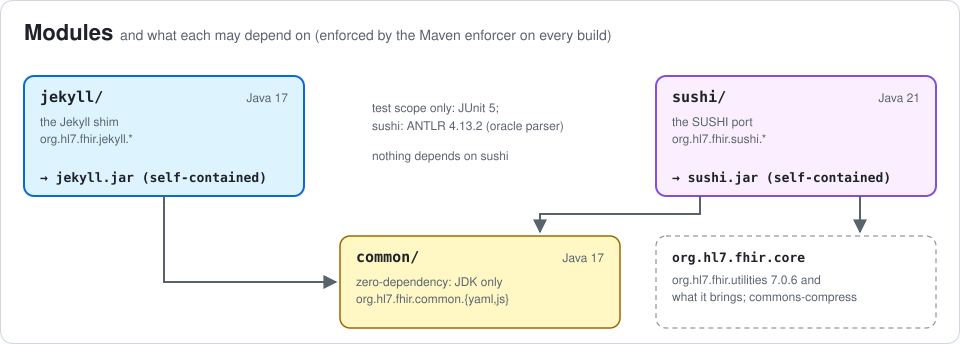

# Multi-module layout

This repository holds Java replacements for the non-Java stages of the FHIR IG Publisher: the Jekyll
replacement ("the shim", module `jekyll`) and the Java port of SUSHI (module `sushi`). They share one Maven
build, so shared code (the YAML event layer, the JS value model) lives in one place, module `common`.

## Layout

```
pom.xml            aggregator and parent: module list, Java level, plugin versions, reproducible-jar timestamp
build.sh           runs the build: Maven (local or in the reference container), or plain javac for the shim (--fast)
common/            zero-dependency shared code, Java 17
  pom.xml          artifact org.hl7.fhir:fhir-ig-common
  src/main/java/org/hl7/fhir/common/yaml/    libyaml 0.2.5 event layer (Reader, Scanner, Token, Parser, Event,
                                             Mark, LibyamlError, ByteString), with an opt-in yaml@1.10 mode
  src/main/java/org/hl7/fhir/common/js/      the JS value model: Js, JsNumber, JsObject, Json, JsonSerializable,
                                             Lodash, Frozen (JSON.stringify/parse, Number formatting, lodash)
  src/test/java/…                            JUnit tests (event layer API, JS value model with node-generated vectors)
  README.md
jekyll/            the shim
  pom.xml          artifact org.hl7.fhir:fhir-ig-jekyll; also writes target/jekyll.jar, the release jar
  src/main/java/org/hl7/fhir/jekyll/…        Shim, IncludeProvider, ShimException, liquid, kramdown, rouge,
                                             yaml (Psych/SafeYAML construction), site, util
  src/test/java/…  main()-style case runners and checks (DiffRunner, ShimApiCheck, …)
  tests/ oracle/   differential suites and the Ruby oracle
  jekyll-shim, jekyll-shim.cmd               the self-downloading wrappers (stamped at release)
  README.md, INTEGRATION.md, NOTES-*.md
sushi/             the SUSHI port, Java 17 (sushi-java before the move, see "The SUSHI module")
  pom.xml          artifact org.hl7.fhir:fhir-ig-sushi; also writes target/sushi.jar (self-contained, shaded)
  src/main/java/org/hl7/fhir/sushi/…         App (CLI), importer (hand-written FSH parser, importer, config),
                                             export, fhirtypes, fshtypes, fhirdefs (packages on org.hl7.fhir.core),
                                             ig, run, utils, xhtml, yaml (the yaml@1.10 composer over common's events)
  src/test/java/…, src/test/antlr4/          JUnit tests (~3.7k), SUSHI's grammar for the ANTLR test oracle
  scripts/         build.sh (module build), diff-run.sh / corpus-diff.sh (differential vs TypeScript SUSHI), oracles
  sushi, sushi.cmd                           the self-downloading wrappers (stamped at release)
  tests/           inventory.tsv (Jest → JUnit), e2e/ig (the wrapper end-to-end project)
  PORTING.md, README.md, docs/
scripts/           test drivers, corpus and golden tools; sushi-e2e.sh, test-sushi-wrapper.sh; sushi-sync.sh and
                   sushi-restructure.sh (importing/re-syncing the SUSHI port)
docs/              this file, img/ (the diagrams), TRACKER.md, archive/
docker/ lima/ third_party/ tracker-app/
```

## Naming decisions (M1–M3: placeholders until the owner decides; M4: decided)

| Decision | Choice | Notes |
|---|---|---|
| M1 shared package | `org.hl7.fhir.common.*` (YAML: `org.hl7.fhir.common.yaml`) | Matches the siblings `org.hl7.fhir.jekyll` and `org.hl7.fhir.sushi`. Avoids `org.hl7.fhir.igtools`, which is the IG Publisher's own namespace. |
| M2 Maven coordinates | `org.hl7.fhir:fhir-ig-tools-parent`, `fhir-ig-common`, `fhir-ig-jekyll`, `fhir-ig-sushi`; version `0.2.0-SNAPSHOT` | Nothing is published to a Maven repository yet (the POMs are ready: "Publishing to Maven Central"). The release version still comes from the git tag (`scripts/stamp-wrappers.sh`), not from the POM. |
| M3 module directories | `common/`, `jekyll/`, `sushi/` (`sushi/` was developed as the separate `sushi-java` repository) | The jar names are `jekyll.jar` and `sushi.jar`; the wrapper names `jekyll-shim`, `jekyll-shim.cmd`. |
| M4 repository name | `fhir-ig-tools` (decided) | Names that refer to the Jekyll tool, not the repository: the module artifact `fhir-ig-jekyll`, the offline bundle `fhir-ig-jekyll.zip`, the wrappers' cache `~/.fhir-ig-jekyll/` and their `FHIR_IG_JEKYLL_*` variables. |

## Building

You need JDK 17+ and Maven 3.6.3+ for the whole build. Without them,
`./build.sh` runs the same commands in the reference image, whose JDK is Temurin 21. `common` and `jekyll` are
compiled with `--release 17` whatever the JDK, so `jekyll.jar` keeps running on Java 17.

```sh
./build.sh                          # = mvn -B -q package: all modules, unit tests, jars
./build.sh -B -ntp package          # same, with normal output (what CI runs)
./build.sh -B -pl jekyll -am package   # one module and what it needs (the shim)
./build.sh -B -pl sushi -am package    # SUSHI (sushi/scripts/build.sh wraps this; SUSHI_BUILD_DIR moves sushi's target/)
mvn -B package                      # plain Maven works too
./build.sh --fast                   # shim only, plain javac, no Maven: common + jekyll -> jekyll/build/{classes,test-classes,jekyll.jar}
./build.sh --fast yaml              # one jekyll package (liquid|kramdown|site|yaml|rouge) + util + common -> jekyll/build-yaml/
```

There is no `--fast` build for `sushi`: it needs Maven for org.hl7.fhir.core and for the ANTLR test oracle.
Every module is compiled with `--release 17` (the IG Publisher's level); the enforcer requires JDK 17 or newer.

Outputs:
- Maven: `common/target/classes`, `jekyll/target/classes`, `jekyll/target/test-classes`, the thin module jar
  `jekyll/target/fhir-ig-jekyll-<version>.jar`, and **`jekyll/target/jekyll.jar`**. That last one is self-contained:
  common's YAML event layer is shaded in (its JS value model is left out, the shim doesn't use it), and
  `Main-Class` is `org.hl7.fhir.jekyll.site.Main`.
- Maven, sushi: `sushi/target/fhir-ig-sushi-<version>.jar` (module classes only) and **`sushi/target/sushi.jar`**
  (about 78 MB): `common`, org.hl7.fhir.utilities and r4/r4b/r5, xpp3, commons-compress and the libraries core
  brings, shaded into one
  jar with `Main-Class` `org.hl7.fhir.sushi.App` and `Multi-Release: true` (some bundled libraries are multi-release
  jars). `java -jar sushi.jar <ig dir>` runs like `sushi <ig dir>`.
- `--fast` puts common's classes into each output dir's `classes/` as well, so `-cp <dir>/classes:<dir>/test-classes`
  is a complete classpath. The per-package builds let parallel workers compile their own package while someone
  else's half-finished code elsewhere doesn't compile. `BUILD_OUT=<dir>` picks another dir under `jekyll/`.
- The jars are reproducible: the POM sets `project.build.outputTimestamp`, so the same sources built with the
  same JDK give the same `jekyll.jar` (and `sushi.jar`) bytes.

`./build.sh` runs locally when `javac` and `jar` actually run (macOS's `/usr/bin/javac` stub without a JDK
doesn't count) and, for Maven builds, when `mvn` is on the PATH. Otherwise it runs in the reference image
(`ig-publisher-localdev-ca`; `DOCKER_CONTEXT` / `DOCKER_HOST` select the daemon) with:
- the checkout mounted at its own path, so `target/` dirs appear in the checkout as with a local build;
- Maven 3.9.9 and its local repository on the Docker host's disk (`$VMDATA/fhir-ig/{tools,m2}`, D11), not in the
  checkout. Maven is fetched from Maven Central on first use and checked against a pinned SHA-512.

`BUILD_DOCKER=1` forces the container. `SHIM_BUILD_DOCKER=1`, the old variable, still works.

## Testing

| What | Command | Notes |
|---|---|---|
| Unit tests (JUnit) | part of `./build.sh` (`mvn package`) | `common` (event layer API, JS value model) and `sushi` (~3.7k, mostly 1:1 ports of SUSHI's Jest tests). Self-contained: SUSHI's test fixtures are vendored (`sushi/src/test/resources/sushi-ts`). 22 tests over data outside the repository (corpus, recorded TS runs) are opt-in: `-Dsushi.vmdata=$VMDATA` (`sushi/README.md`, "Tests") |
| SUSHI differential, one IG | `sushi/scripts/diff-run.sh <IG> [label]` | TypeScript SUSHI 3.21.1 vs `sushi/target/sushi.jar` on the same source copy and frozen package snapshot: classified file diff, log diff, exit codes. Needs the corpus workspace (`ROOT`, default the repository root, with `work/sushi-spike`) and the reference runs on the VM |
| SUSHI differential, corpus | `sushi/scripts/corpus-diff.sh [-j N] [list]` | `diff-run.sh` over the 267 FSH IGs |
| Differential suites vs recorded Ruby output | `scripts/test-suites.sh` | builds with Maven first unless `SHIM_NO_BUILD=1`. Runs against `jekyll/target/jekyll.jar` + `test-classes`, i.e. the release jar itself. `SHIM_BUILD=jekyll/build[-<module>]` tests a `--fast` build instead. `SHIM_W_SUITES=1` (repo at `/w`) adds the YAML file suites. |
| In-process API | `java -cp jekyll/target/jekyll.jar:jekyll/target/test-classes org.hl7.fhir.jekyll.test.site.ShimApiCheck` | |
| Wrapper end to end | `scripts/e2e.sh` | `jekyll/jekyll-shim` picks up `jekyll/target/jekyll.jar` (then `jekyll/build/jekyll.jar`) in a source checkout |
| Wrapper bootstrap | `scripts/test-wrapper.sh [jar]` | defaults to `jekyll/target/jekyll.jar` |
| SUSHI wrapper end to end | `scripts/sushi-e2e.sh [wrapper-dir] [sushi.jar]` | `sushi/tests/e2e/ig` through the wrapper (default `sushi/sushi`, which picks up `sushi/target/sushi.jar`) and through `java -jar sushi.jar`: same `fsh-generated/`, output and exit status; `--version` and an error exit pass through. Downloads the FHIR packages the project needs on first use |
| SUSHI wrapper bootstrap | `scripts/test-sushi-wrapper.sh [jar]` | a stamped `sushi` wrapper downloads, verifies and caches the jar (local HTTP server), works offline from the cache, refuses a bad checksum, and stops with a clear message on Java < 21 |
| Golden corpus | `scripts/shim-golden.sh`, `scripts/shim-all.sh` | use a `--fast` build dir (default `build-site`) |
| Output regression between two jars | `scripts/jar-compare.sh <golden> <ref.jar> <new.jar>...` | byte-for-byte, every output file; for refactors that must not change output |

`jekyll/run.sh` and `jekyll/oracle/oracle.sh` work as before. `BUILD=<dir>` selects a `--fast` dir; leave
`BUILD` unset to use the Maven build.

## Module rules



The Maven enforcer plugin checks the dependency rules on every build (`bannedDependencies`).

| Module | Java | May depend on | Must not |
|---|---|---|---|
| `common` | 17 (`--release 17`) | nothing (JDK only); test-scope libraries such as JUnit are fine | depend on any other module or library, or carry one tool's semantics by default. Put a port's shared lower layer here; behavior only one tool needs is opt-in (like the event layer's yaml110 mode), never the default. |
| `jekyll` | 17 | `common` only (plus test scope) | depend on `sushi` or any library: `jekyll.jar` must stay a self-contained, dependency-free jar that runs on Java 17 |
| `sushi` | 21 | `common`, the FHIR core libraries the IG Publisher ships (`ca.uhn.hapi.fhir:org.hl7.fhir.*`; today `org.hl7.fhir.utilities` for the package cache and `r4`/`r4b`/`r5` for predefined FHIR XML), xpp3 (core's XML parsers need it), commons-compress at runtime (core's package cache needs it), test-scope libraries (JUnit, the ANTLR oracle). Enforcer `bannedDependencies` checks the direct dependencies; `build.DependencyRuleTest` checks that main code imports only the JDK, `org.hl7.fhir.{sushi,common,utilities}` (and r4/r4b/r5 model classes in `fhirdefs/FhirXml`), not the libraries core brings along | be depended on by `common` or `jekyll` |

More rules:
- Each package lives in exactly one module (`org.hl7.fhir.common.*` in `common`, `org.hl7.fhir.jekyll.*` in `jekyll`,
  `org.hl7.fhir.sushi.*` in `sushi`). No split packages, so a JPMS module split stays possible later.
- `common` keeps a Java 17 floor because the shim's does. Code moved into `common` must compile with `--release 17`:
  no pattern-matching `switch`, no `SequencedCollection` methods (`getFirst()`, `reversed()`, ...), and so on.
- `common`'s public types are an API for both tools. Change them in the same commit as all their callers, and
  run both modules' suites.

### The YAML event layer in `common`

`org.hl7.fhir.common.yaml` is the libyaml 0.2.5 port (reader, scanner, parser), moved unchanged from
`org.hl7.fhir.jekyll.yaml`. The public surface is what an event consumer needs:

```java
Parser p = new Parser(bytes, Parser.UTF8_ENCODING);   // or ANY_ENCODING (BOM detection), UTF16LE/BE_ENCODING
for (Event e; (e = p.parse()) != null; ) {
  switch (e.type) { case SCALAR -> ... e.value, e.anchor, e.tag, e.style, e.plainImplicit, e.quotedImplicit, e.startMark ... }
}
// errors: LibyamlError (RuntimeException) with error (READER/SCANNER/PARSER_ERROR), problem, problemOffset,
//         problemValue, problemMark, context, contextMark: libyaml's own error state, no tool-specific wording
```

`Event` mirrors `yaml_event_t`. Its fields are public and should be treated as read-only. Strings are UTF-8
`byte[]`, and the `*_STYLE` constants are on `Event`. `Reader`, `Scanner`, `Token` and `ByteString` stay
package-private. The Psych/SafeYAML construction (`PsychParser`, `PsychHandler`, `Transform`, `Yaml`, the `Ruby*`
value types, `PsychSyntaxError` wording) stays in `jekyll`.

`new Parser(bytes, encoding, true)` selects the **yaml110 mode**, which SUSHI's yaml@1.10 composer uses: the few
relaxations where eemeli/yaml 1.10 (YAML 1.2) accepts input libyaml 0.2.5 rejects (any character allowed and only
CR/LF break lines; tabs on otherwise blank lines and at the end of plain-scalar lines; `%` starting a plain scalar
after column 0; a block-mapping value without a key). It is off unless asked for; the two-argument constructor,
which the shim uses, is exactly libyaml. The composer itself (`org.hl7.fhir.sushi.yaml.Yaml`, `YamlError`: YAML 1.2
core-schema typing, anchors, duplicate keys, yaml@1.10's error wording) stays in `sushi` and uses only this public
API.

### The JS value model in `common`

`org.hl7.fhir.common.js` is SUSHI's model of JavaScript values (`sushi/PORTING.md` D3/D4): objects are
insertion-ordered `JsObject` maps, numbers are `Double`, `Json.stringify`/`parse`/`outputJson` behave like
`JSON.stringify`/`JSON.parse` (ECMAScript number formatting, escaping, key order), `Js`/`Lodash` hold the lodash
functions SUSHI uses, and `Frozen` gives deeply frozen views. It is zero-dependency and Java 17, so other modules
can use it; the shim doesn't today.

## The SUSHI module

The SUSHI port was developed in its own repository (`sushi-java`; Maven, Java 21, package `org.hl7.fhir.sushi`)
and moved in with its history. Two scripts do the mechanical part, so the move can be repeated when the port's
repository gets more commits:

- `scripts/sushi-sync.sh <sushi-port-repo> [branch]` clones the branch, rewrites it with git filter-repo (every
  path under `sushi/`; author and committer identities set to this repository's `user.name`/`user.email`;
  workspace paths in file contents and commit messages replaced), and merges it (the first time with
  `--allow-unrelated-histories`). filter-repo is deterministic, so a re-sync rewrites the commits imported before to
  the same ids and the merge brings only the new ones. Then it runs:
- `scripts/sushi-restructure.sh` (idempotent): moves `org.hl7.fhir.sushi.js` to `common` as `org.hl7.fhir.common.js`
  (with `JsonTest`, `FrozenTest` and their vectors; `LodashTest`, which also checks `utils.ValidUrl`, becomes
  `sushi`'s `utils.LodashOracleTest`), rewrites every reference to the old package in code (not in Markdown, where the docs name it on purpose), deletes sushi's vendored copy of
  the libyaml event layer, and points the yaml@1.10 composer at `common`'s event layer in yaml110 mode. It stops
  with an error if something new needs a hand decision (a new test in the js package, the composer using the event
  layer's internals).

Changes made by hand, as ordinary commits after the import: `sushi/pom.xml` (parent, `fhir-ig-sushi`, enforcer
rules, the shaded `sushi.jar` instead of the old `lib/` class path), `DependencyRuleTest` (allows `common`, expects
`fhir-ig-common` among the runtime dependencies), `sushi/scripts` (build through `../build.sh`; `diff-run.sh` runs
and mounts `sushi/target/sushi.jar`; `ROOT` defaults to the repository root instead of a fixed path), and the docs.
On a re-sync, a conflict in one of those files means the port's repository changed it too: keep this repository's
version and re-apply the upstream change by hand.

## Releases

- **Build with JDK 21.** CI and the release workflow use JDK 21 for the whole build; every module is compiled with
  `--release 17` (`jekyll.jar`'s class files are version 61, checked in CI), CI also builds and tests everything on
  JDK 17, and CI jobs run the same `jekyll.jar` and `sushi.jar` on JDK 17 and 21 on Linux, macOS and Windows.
- **Release assets:** `jekyll-shim`, `jekyll-shim.cmd` (stamped with the release version and `jekyll.jar`'s
  SHA-256; on first use they download `releases/download/v<version>/jekyll.jar`, verify it and cache it under
  `~/.fhir-ig-jekyll/<version>/`), `jekyll.jar`, `fhir-ig-jekyll.zip` (offline bundle: `jekyll.jar`, both wrappers,
  README, licenses, `INTEGRATION.md`); `sushi`, `sushi.cmd` (stamped the same way for `sushi.jar`, cache
  `~/.fhir-ig-sushi/<version>/`), `sushi.jar`; and `SHA256SUMS` over all of them. The version comes from the git
  tag (`scripts/stamp-wrappers.sh`, `--sushi` for the SUSHI wrappers), not from the POM. The workflow runs both
  wrappers end to end before publishing, and again against the published assets.
- **jekyll.jar:** one self-contained jar, `Main-Class` `org.hl7.fhir.jekyll.site.Main`, CLI
  `java -jar jekyll.jar build --destination <dir>`, no dependencies: common's YAML event layer is shaded in (its JS
  value model is left out). The in-process route (the publisher calling `Shim.build`) can use it as one jar; a Maven
  consumer would use `fhir-ig-jekyll` + `fhir-ig-common`, which are not published to a Maven repository yet
  ("Publishing to Maven Central" below).
- **sushi.jar:** one self-contained jar (about 40 MB), `Main-Class` `org.hl7.fhir.sushi.App`, `Multi-Release: true`,
  SUSHI's command line. It bundles `common`, org.hl7.fhir.core's utilities and their libraries; their Apache
  `NOTICE` files are merged into `META-INF/NOTICE`, and `THIRD_PARTY_NOTICES.md` (which lists every bundled library
  and its license) and the repository license are in `META-INF/fhir-ig-tools/`.
- **CI:** the `build` job (JDK 21, Linux) builds everything and runs all JUnit tests and the shim suites; the `shim`
  job runs that `jekyll.jar` on JDK 17 and 21 on Linux, macOS and Windows; the `sushi` job runs that `sushi.jar`
  through the wrapper (`sushi-e2e.sh`, `test-sushi-wrapper.sh`) on Linux, macOS and Windows with JDK 17 and 21; the
  `jdk17` job builds every module and runs all JUnit tests on JDK 17.

## Publishing to Maven Central

The POMs are ready for Central (2026-11-23): every module has name, description, URL, license, developer, SCM and
issue tracker (inherited from the parent), and the `central` profile attaches `-sources` and `-javadoc` jars, signs
(maven-gpg-plugin, `bc` signer) and deploys through Sonatype's Central Portal plugin (`central-publishing-maven-plugin`
0.8.0, server id `central`, `autoPublish` off). Signing is off unless `-Dgpg.skip=false`.

Dry run (what was checked; nothing is uploaded): set a release version, then build the bundle with a placeholder
`central` server in a settings file:

```sh
mvn -B versions:set -DnewVersion=0.2.1 -DgenerateBackupPoms=false   # Central takes no -SNAPSHOT releases
mvn -B -s settings-with-central-server.xml -P central -DskipTests -DskipPublishing deploy
unzip -l target/central-publishing/central-bundle.zip   # parent pom; common, jekyll, sushi: pom, jar, -sources, -javadoc, checksums
```

What a real publication still needs (none of it can be done from this repository alone):
1. **A namespace on Central.** `org.hl7.fhir` belongs to HL7 (the namespace org.hl7.fhir.core publishes under);
   publishing there needs HL7 to grant this project's Central account that namespace (or publish it from HL7's
   account). The alternative is a namespace we own (e.g. `io.github.jmandel`, verified through GitHub), which means
   renaming the groupId in the four POMs (and in the publisher's dependency).
2. **A signing key:** a GPG key pair for the project, its public key on a keyserver (keys.openpgp.org /
   keyserver.ubuntu.com), the private key and passphrase as repository secrets (`MAVEN_GPG_KEY`,
   `MAVEN_GPG_PASSPHRASE`).
3. **A Central Portal user token** as secrets (`CENTRAL_USERNAME`, `CENTRAL_PASSWORD`), written to `settings.xml`
   as server `central` (e.g. `actions/setup-java` with `server-id: central`).
4. **A release-workflow step** after the tests: `mvn versions:set -DnewVersion=${TAG#v}` and
   `mvn -B -P central -Dgpg.skip=false -DskipTests deploy`, then "Publish" the validated deployment in the portal
   (or set `autoPublish`).
5. **Decide what is published:** today all four artifacts (parent, `fhir-ig-common`, `fhir-ig-jekyll`,
   `fhir-ig-sushi`). The publisher needs `fhir-ig-jekyll` (the thin jar, 0.6 MB) and `fhir-ig-common` (65 KB);
   `fhir-ig-sushi` could be left out with `-DexcludeArtifacts=fhir-ig-sushi`.

## Verification of the multi-module move (2026-11-22)

The shim's jar was built as `shim.jar` at this point; it is the same jar as today's `jekyll.jar` apart from the name.

All checks were run from the `multimodule` branch, in the reference image.
- Unit tests: `common` JUnit 5/5.
- `scripts/test-suites.sh` with `SHIM_W_SUITES=1`, run against the Maven `shim.jar` and again against a
  `--fast` build: every suite passed, with the same `known` counts as before.
- Extra YAML and markdown suites: real `_config`/`_data` 100/100, front matter 310/310, `_data` files 583/583
  (4 cases name a golden no longer on disk), markdown corpus 2207/2207.
- `LiquidWarnCheck`, the kramdown/Rouge concurrency checks, `PreMatchEquivalence`, `JavaSignatureEquivalence`
  and `ShimApiCheck` (13/13) all pass on both builds.
- `scripts/e2e.sh` and `scripts/test-wrapper.sh` pass with the Maven jar.
- Release `Package` dry run, without `zip` (the image has none): passed.
- `actionlint`: clean on both workflows.
- Golden sample: `scripts/jar-compare.sh` ran the v0.1.0 release `shim.jar`, the pre-move `main` jar and the
  new Maven `shim.jar` on 25 IGs. All 205,545 output files were byte-identical across the three jars. The IGs:
  HL7__US-Core, IHE__ITI.MHD, FHIR__fhir-tools-ig, HL7__genomics-reporting, kitchen-sink, kitchen-sink-r4,
  HL7__fhir-extensions, HL7__UTG, hl7ch__ch-core, hl7au__au-fhir-core, hl7-eu__xshare-ips-plus,
  HL7__fhir-us-quality-core, hl7korea__krcore, HL7Chile__IPS-CL, HL7__FHIRPath, HL7__sql-on-fhir,
  HL7__bulk-data, HL7__cds-hooks, WorldHealthOrganization__smart-base, HL7__davinci-dtr, IHE__PCC.ODH,
  Nictiz__NL-PS-IG, HL7__fhir-udap-security-ig, HL7__case-reporting, hl7-eu__extensions.
- A 26th IG, `fut-infrastructure__implementation-guide`, cannot match v0.1.0, by design: v0.1.0 fails on
  ``, which commit fc062482 fixed after the release. On that IG the new jar is
  byte-identical to `main` (17,800 files).
- The CLI behaves the same on bad or missing arguments, and a clean rebuild reproduces `shim.jar`
  byte for byte.

## Verification of the SUSHI move (2026-11-22)

The shim's jar in these checks was built as `shim.jar`; `jekyll.jar` is the same file under its final name (see
"Jar names" below).

Branch `monorepo-sushi` (from `multimodule` 29c24084), with the SUSHI port imported from its repository's final
`main` (12cf612) by `scripts/sushi-sync.sh`. All checks in the reference image (Temurin 21).
- **Build:** `./build.sh -B -ntp clean package` green. JUnit: `common` 13/13 (event layer 6, incl. the yaml110
  opt-in; JS value model 7), `sushi` 3,706 run, 0 failures, 29 skipped. Together that is 3,713 tests and 29 skipped, the same as the
  port's own repository reports at 12cf612 (`sushi/PORTING.md` §9). Enforcer rules pass; the
  dependency rule test passes.
- **SUSHI differential:** `sushi/scripts/diff-run.sh` with the new `sushi/target/sushi.jar` on the 6 reference IGs
  (HL7__genomics-reporting, IHE__ITI.MHD, hl7ch__ch-term, EEHRxF__logical-model, ahdis__ch-ekm,
  WorldHealthOrganization__smart-anc): all identical to TypeScript SUSHI 3.21.1, 2,153 files byte for byte, logs
  identical, exit codes 0/0, the same result as the port's own jar. (Run at the 258aa8c sync; the 12cf612 sync
  changed only a test and PORTING.md, and the rebuilt `sushi.jar` is byte-identical to the one run.)
- **Shim suites:** `scripts/test-suites.sh` with `SHIM_W_SUITES=1` against the Maven `jekyll.jar` and against a
  `--fast` build: every suite passes with the same pass and `known` counts as on `multimodule`. Extra checks: real
  `_config`/`_data` 100/100, front matter 310/310, `_data` files 583/587 (the same 4 cases name a golden no longer on
  disk), markdown corpus 2207/2207, `LiquidWarnCheck`, the kramdown/Rouge concurrency checks, `PreMatchEquivalence`,
  `JavaSignatureEquivalence`, `ShimApiCheck` 13/13.
- **Golden sample:** `scripts/jar-compare.sh` with the `multimodule` `jekyll.jar` (rebuilt from 29c24084, byte-identical
  to the one verified above) against the new one on IHE__ITI.MHD, FHIR__fhir-tools-ig, HL7__genomics-reporting,
  kitchen-sink and hl7ch__ch-core: all 21,174 output files byte-identical. (Run before the final re-sync, which
  changed only sushi's tests and docs; the rebuilt `jekyll.jar` is byte-identical to the one compared.)
- `scripts/e2e.sh`, `scripts/test-wrapper.sh` and a dry run of the release `Package` step (without `zip`) pass.
- `actionlint` (1.7.7, with shellcheck): clean on both workflows.
- Reproducible: a clean rebuild gives the same `jekyll.jar` and `sushi.jar` bytes.
- History: the 130 imported commits carry this repository's author identity and no workspace paths; two later
  `sushi-sync.sh` runs on the updated `main` reused the earlier rewritten commits and merged only the new ones.

### Jar names

- `jekyll/target/jekyll.jar` is byte-identical to the jar the checks above ran (same SHA-256; only the output
  file name differs), and `scripts/jar-compare.sh` against the `multimodule` jar gives identical output on
  IHE__ITI.MHD (2,112 files) and kitchen-sink (4,031 files).
- With the final names: a clean build (common 13, sushi 3,707 / 0 failures / 29 skipped), `scripts/test-suites.sh`
  with `SHIM_W_SUITES=1` (Maven jar and `--fast` build, which writes `jekyll/build/jekyll.jar`), `ShimApiCheck`,
  `scripts/e2e.sh` (the wrapper finds `jekyll/target/jekyll.jar`), `scripts/test-wrapper.sh` (a stamped wrapper
  downloads, verifies and caches `jekyll.jar`), a release `Package` dry run (stamped wrappers name
  `.../releases/download/v<version>/jekyll.jar`; `SHA256SUMS` lists `jekyll.jar`) and `actionlint`: all pass.

### The sushi wrappers and the released sushi.jar

- `scripts/sushi-e2e.sh` (source-checkout wrapper) and `scripts/test-sushi-wrapper.sh` (stamped wrapper: download,
  checksum, cache, offline, bad checksum, Java < 21 message) pass in the reference image; a release `Package` dry run
  stamps both wrappers, runs `sushi-e2e.sh` on the stamped `sushi` wrapper and writes `SHA256SUMS` over all assets.
- They found a bug the differential runs could not: on a machine without `~/.fhir/packages`, every package failed to
  download (core's cache manager refuses a missing folder; fhir-package-loader creates it). Fixed in
  `fhirdefs.CorePackageProvider`, with a regression test (sushi now runs 3,707 tests; with common's JS tests 3,714).
- The final `sushi.jar` (with that fix and the merged notices) gives the same result on the 6 reference IGs as above:
  2,153 files byte-identical, logs identical, exit codes 0/0. `jekyll.jar` is unchanged by these commits (same
  SHA-256). A clean rebuild reproduces both jars byte for byte.
